<div align="center">

<picture>
  <source media="(prefers-color-scheme: dark)" srcset="docs/assets/logo-dark.png">
  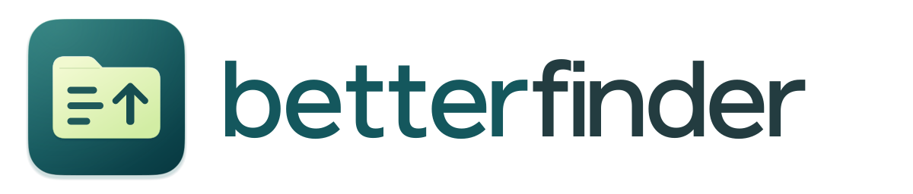
</picture>

**finder but better.** native macos file manager that does not suck. check out all the features below...

[](https://github.com/bryanthaboi/betterfinder/releases/latest)


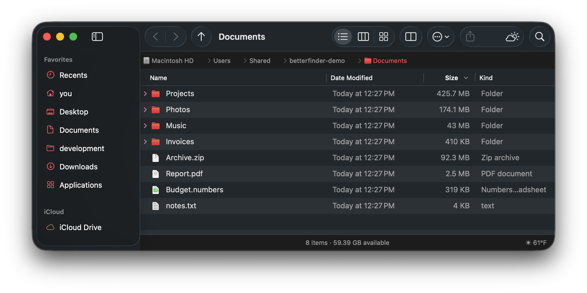

</div>

If you enjoy this project, you can **support its continued development** (and me) on Patreon or Github
<div align="center">

[](https://www.patreon.com/bryanthaboi) [](https://github.com/sponsors/bryanthaboi)
</div>

[download the latest release](https://github.com/bryanthaboi/betterfinder/releases/latest), open the dmg, drag it to applications.

## what it does

### top 8 features imho iykyk

1. **folder sizes off a real index.** a background file index puts sizes right in the size column. name search runs off it too, so <kbd>⌘</kbd><kbd>F</kbd> is basically instant even across ur whole home

   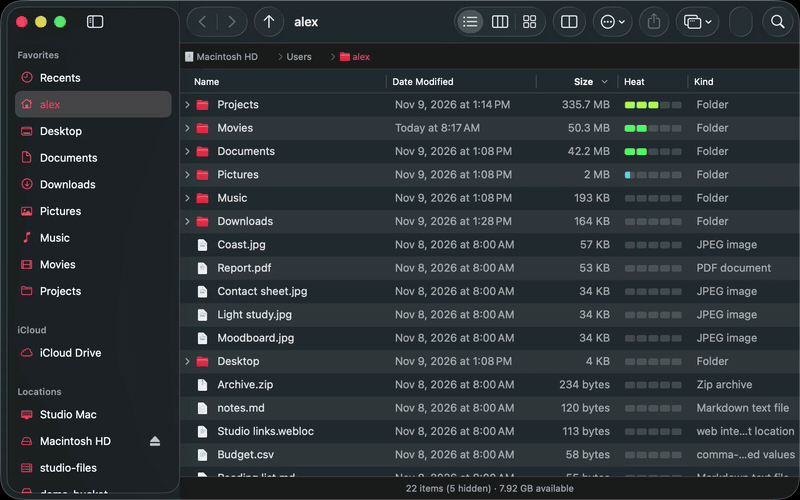
2. **see whats eating ur disk.**
   - **heat column.** a little colored bar per row, blue for tiny up to red for huge, same scale in every folder. click the header to sort by it
   - **space hog.** view → space hog (<kbd>⌃</kbd><kbd>⌘</kbd><kbd>H</kbd>) draws it as a map, windirstat style, straight off the index so it opens instantly. double click to zoom in, tiny numbers at the bottom say how far along the index is
   - **clean up junk.** finds caches, logs, package manager leftovers, rebuildable project folders, old installers and piles of empty leftover folders. nothing is ticked for u, and everything goes to the trash

   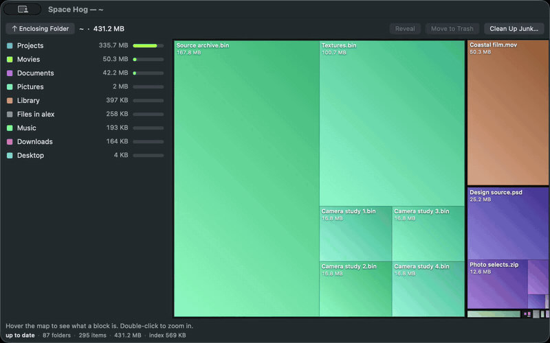
3. **visor w a built in terminal.** totalfinder style. a betterfinder window slides up from the bottom of ur screen on a hotkey, from any app
   - <kbd>⌥</kbd><kbd>`</kbd> or double tap <kbd>⌥</kbd>. slides away when u switch apps, pin it to keep it, shows on every space and can sit above the dock
   - <kbd>⌃</kbd><kbd>`</kbd> splits it w a real terminal on the right half. tabs, and whatever shell u like: zsh, bash, fish, nu or anything else
   - flip a setting and open in terminal lands there instead of terminal.app, or send every new window into the visor as a tab

   
4. **tabs, dual pane + windows ur way.**
   - <kbd>⌘</kbd><kbd>⇧</kbd><kbd>D</kbd> or double click a tab for two panes, <kbd>F5</kbd>/<kbd>F6</kbd> copy/move across, <kbd>⌥</kbd><kbd>⇥</kbd> hops between em. each pane can have its own sidebar
   - drag files onto a tab to move em there, drag a folder between two tabs to open it as a new one
   - one toolbar button merges every window into tabs, splits em back out, or moves a tab, a window or all of em into the visor. right click the close button to close all

   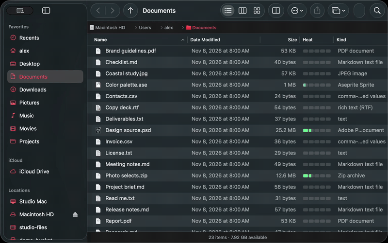
5. **base finder stuff that has always sucked is fixed.**
   - list view default, sort + layout stick everywhere, never writes `.DS_Store`. <kbd>⇧</kbd><kbd>⌘</kbd><kbd>;</kbd> keeps folders on top
   - <kbd>⌘</kbd><kbd>↑</kbd> goes up from anywhere, incl search results + recents, and selects where u came from
   - path bar u can type in. <kbd>⌘</kbd><kbd>L</kbd>, tab completion, `~`, paste a `file://` url
   - real cut + paste. <kbd>⌘</kbd><kbd>X</kbd> then <kbd>⌘</kbd><kbd>V</kbd> moves it. like a normal computer
   - filter as u type. type `*.zip` and the folder narrows instantly, or right click a kind → filter by. <kbd>esc</kbd> clears it
   - <kbd>⌘</kbd><kbd>F</kbd> searches where u are, not "this mac"

   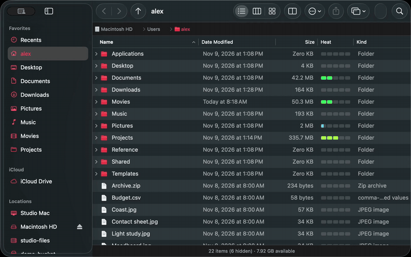
6. **file operations u can trust.**
   - copy queue. pause, resume, retry, conflict dialog w apply-to-all, undo everything, optional checksum verify
   - put back that works. own trash journal so it doesnt randomly break. file → recently trashed… lists it all
   - eject tells u who's blocking. names the app holding the drive + offers to quit it
7. **sftp + s3.** <kbd>⌘</kbd><kbd>K</kbd> to connect. browse, copy, move between local, sftp, s3 (r2/minio too). moves verify before deleting
8. **make it urs.** [9 themes](#themes) every one editable live and exportable as `.bftheme`. [mods](#mods) add panels, columns, toolbar buttons, commands and more, sandboxed + checked before they turn on, and the mcp server can help your ai agent do it all for you - if you can dream it you can ... do it i think thats a quote from something

   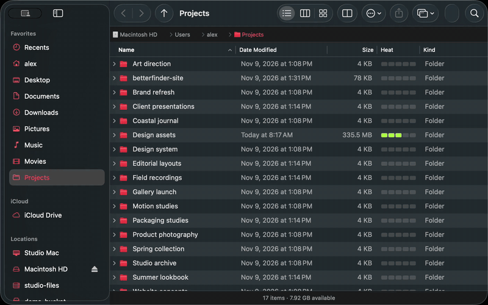

### also

- **colored labels.** tagged files get the whole row tinted like old finder. list, column and icon view
- **columns that fit.** column view sizes each column to its longest name
- **better right click menu.** new ▸ and open in terminal are always there, w the terminal app of ur choice
- **copy path ur way.** <kbd>⌥</kbd><kbd>⌘</kbd><kbd>C</kbd> for the plain path, or copy path as ▸ url, windows, unc, hfs or terminal escaped
- **get info + mini info.** hold <kbd>⌥</kbd> for a small floating card. drives show capacity + whats used
- **hide ur home name.** show it real, as `~`, custom, or blurred. for screenshots + streams
- **status bar ur way.** reorder or turn off any item, incl ones from mods
- **updates.** checks for new releases and swaps itself in when u let it update

## themes

every theme can be changed/forked and u can share with your buddies

<table>
<tr>
<td align="center">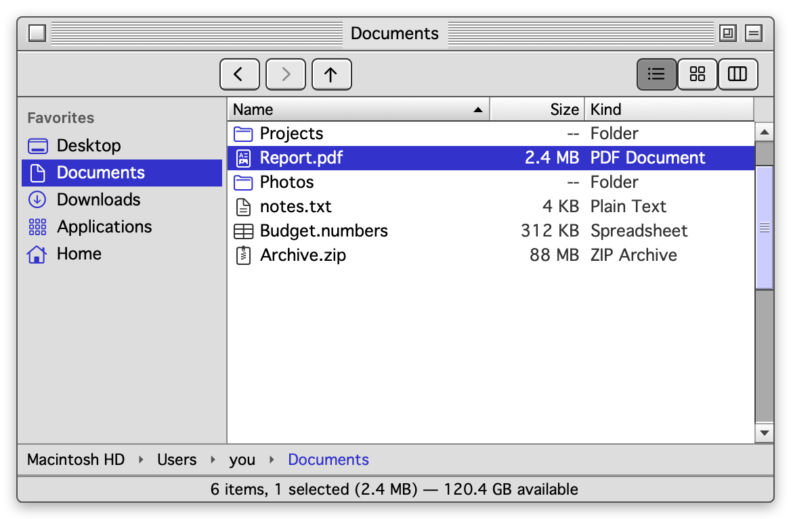<br><sub><b>platinum</b> · mac os 8/9</sub></td>
<td align="center">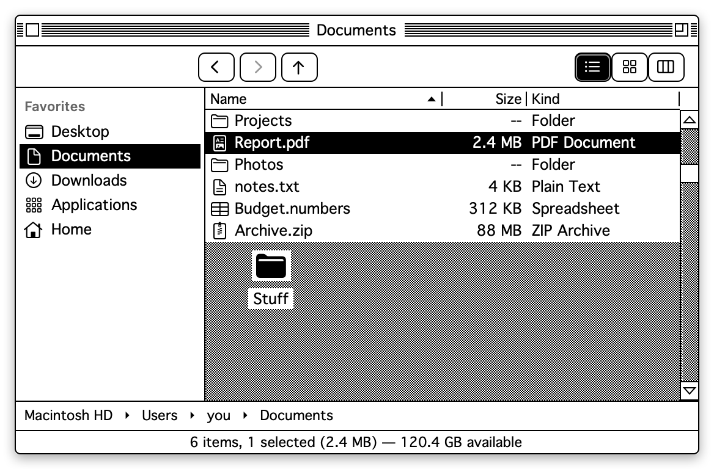<br><sub><b>system 7</b> · 1-bit</sub></td>
<td align="center">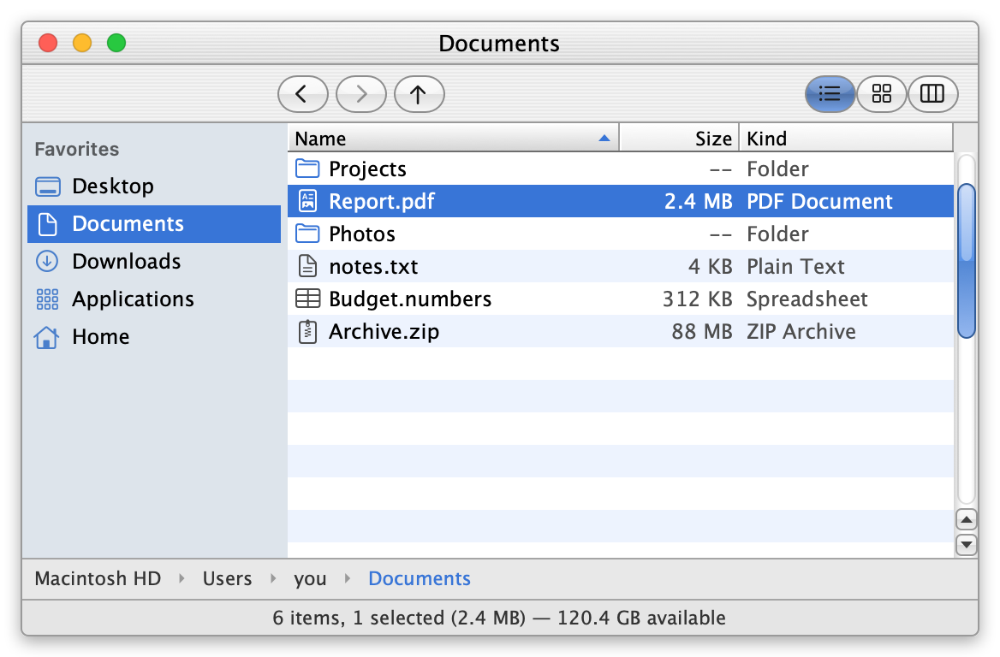<br><sub><b>aqua</b> · early os x</sub></td>
</tr>
<tr>
<td align="center">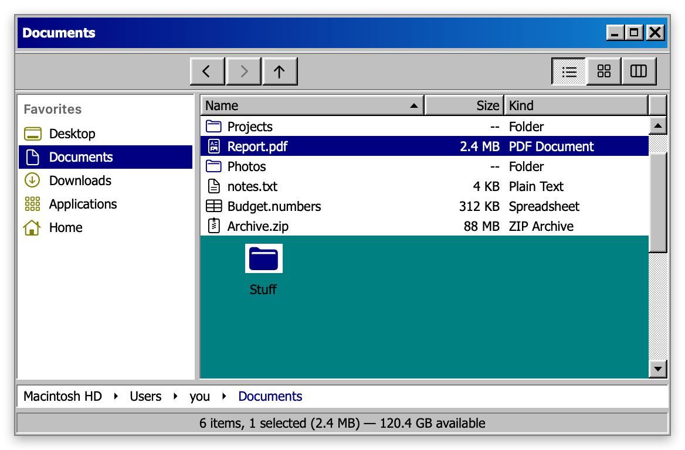<br><sub><b>classic windows</b> · 95/98</sub></td>
<td align="center">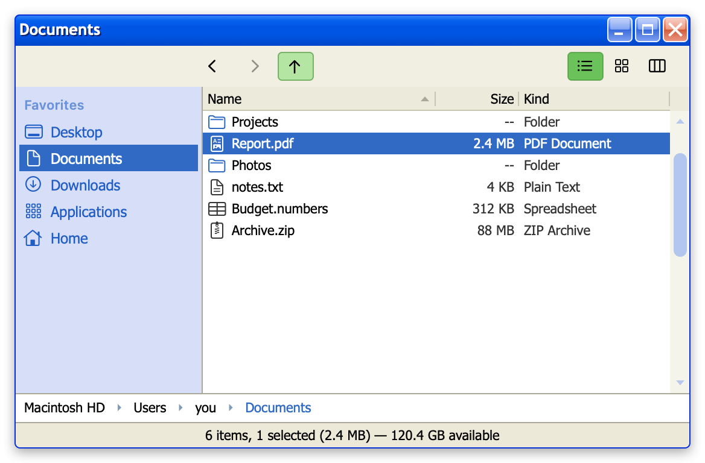<br><sub><b>luna</b> · xp-ish</sub></td>
<td align="center">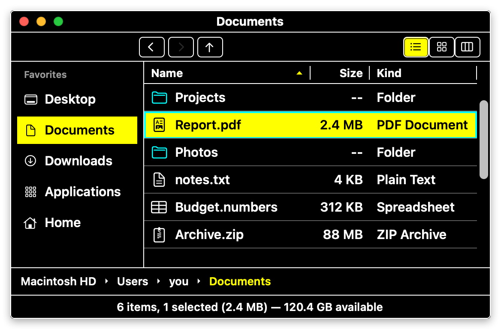<br><sub><b>high contrast</b></sub></td>
</tr>
<tr>
<td align="center"><br><sub><b>modern</b> · follows system</sub></td>
<td align="center">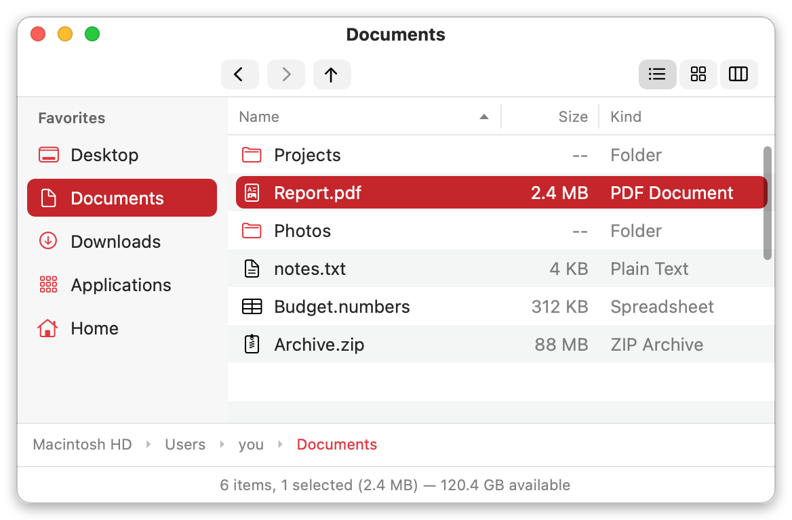<br><sub><b>modern light</b></sub></td>
<td align="center">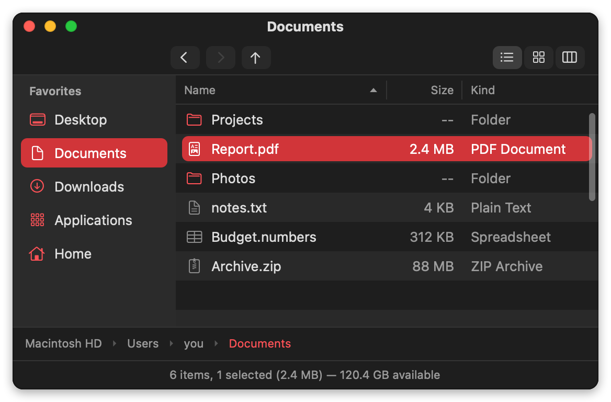<br><sub><b>modern dark</b></sub></td>
</tr>
</table>

retro themes are drawn in code. no apple or microsoft fonts, icons or sounds are shipped.

## replacing finder

macos doesnt let anything fully replace finder. heres what actually moves over:

| what | moves over |
|---|:---:|
| "show in finder" from other apps (vs code, chrome, etc) | yes |
| `open ~/some/folder` + apps opening folders | yes |
| dock stacks / spotlight <kbd>⌘</kbd><kbd>↩</kbd> | sometimes |
| desktop icons, open/save dialogs, airdrop | no |


## more

<details>
<summary><b>build it urself</b></summary>

```sh
brew install xcodegen
xcodegen generate
xcodebuild -project BetterFinder.xcodeproj -scheme BetterFinder -derivedDataPath build/DerivedData build
open build/DerivedData/Build/Products/Debug/betterfinder.app
```

tests per package: `swift test --package-path Packages/Browser` (etc). more in [building + ci](https://github.com/bryanthaboi/betterfinder/wiki/Building)

</details>

<details>
<summary><b>optional windows keys</b></summary>

opt-in in settings. enter opens, f2 renames, backspace goes up, f5 refreshes, forward delete trashes. copy to other pane moves to <kbd>⇧</kbd><kbd>F5</kbd> while its on. ur mac shortcuts still work too.

</details>

## mods

everything is moddable: panels, slide-outs, toolbar buttons, columns, previewers, sidebar sections, commands, file op hooks, themes, icon sets. mods run sandboxed and get checked before they turn on. anything that fails the check stays off.

write em in `bfscript` (typed json), typescript or js. browse + install from settings → mods, or from the [mod index](https://github.com/bryanthaboi/betterfinder-mod-index).

| mod | what |
|---|---|
| [git-panel](https://github.com/bryanthaboi/betterfinder-mod-git-panel) | branch in the status bar, side panel w status + branch switcher, right click → gitignore or hide from git |
| [weather-panel](https://github.com/bryanthaboi/betterfinder-mod-weather-panel) | temp in the status bar, slide-out forecast for ur city |
| [drop-stack](https://github.com/bryanthaboi/betterfinder-mod-drop-stack) | path finder style shelf, stash files then drop em somewhere |
| [folder-notes](https://github.com/bryanthaboi/betterfinder-mod-folder-notes) | sticky notes per folder |
| [trash-cat](https://github.com/bryanthaboi/betterfinder-mod-trash-cat) | a cat in ur status bar that eats ur trash |

turn on developer mode in settings → mods and u get a built in mcp server, so an mcp client can scaffold, test, hot load and package a mod for u. docs live in the [wiki](https://github.com/bryanthaboi/betterfinder/wiki).

<details>
<summary><b>fastest way to start making your own mod</b></summary>

```sh
betterfinder-mod scaffold me.cool-thing --language ts --template panel
betterfinder-mod validate me.cool-thing
```

then mods → load unpacked mod… and it hot reloads on save. [guide →](https://github.com/bryanthaboi/betterfinder/wiki/Modding)

</details>

---

<div align="center"><sub>made by <a href="https://github.com/bryanthaboi">bryanthaboi</a></sub></div>

## license

[GPLv3 with additional terms](LICENSE). Copyright (C) 2026 BOIS CLUB GAMES, LLC.
