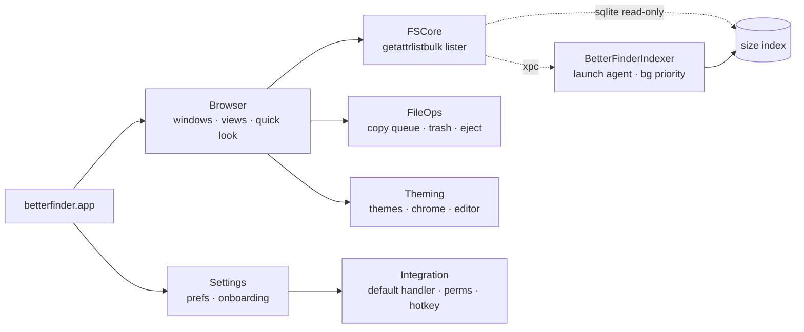

<div align="center">

<picture>
  <source media="(prefers-color-scheme: dark)" srcset="docs/assets/logo-dark.png">
  
</picture>

**finder but better.** native macos file manager. list view by default, real folder sizes, space to preview, an up button that actually works, and themes that go all the way back to system 7.

[](https://github.com/bryanthaboi/betterfinder/actions/workflows/ci.yml)
[](https://github.com/bryanthaboi/betterfinder/actions/workflows/release.yml)


</div>

---

## why

finder is slow, forgets ur view settings, wont show folder sizes, has no real cut/paste, no path bar u can type in, and the up button just... isnt there. this fixes that.

## what it does

| | |
|---|---|
| **list view default** | detailed columns out of the box, sort + layout stick everywhere, never writes `.DS_Store` |
| **folder sizes** | shows in the size column + status bar. backed by a tiny background indexer (~20 MB) so the app itself stays light |
| **space = quick look** | real system quick look, arrow keys follow along, works in list/column/icon views |
| **up button that always works** | <kbd>⌘</kbd><kbd>↑</kbd> from anywhere, incl search results + recents. selects where u came from |
| **path bar u can type in** | <kbd>⌘</kbd><kbd>L</kbd>, tab completion, `~`, paste a `file://` url |
| **real cut + paste** | <kbd>⌘</kbd><kbd>X</kbd> then <kbd>⌘</kbd><kbd>V</kbd> moves it. like a normal computer |
| **tabs + dual pane** | <kbd>⌘</kbd><kbd>⇧</kbd><kbd>D</kbd> for two panes, <kbd>F5</kbd>/<kbd>F6</kbd> copy/move across |
| **copy queue** | pause, resume, retry, conflict dialog w apply-to-all, undo everything (replace sends the old copy to the trash so undo can bring it back), optional checksum verify |
| **put back that works** | own trash journal so put back doesnt randomly break. file → recently trashed… lists it all |
| **eject tells u who's blocking** | names the app holding the drive + offers to quit it |
| **sftp + s3** | <kbd>⌘</kbd><kbd>K</kbd> to connect. browse, copy, move between local, sftp, s3 (r2/minio too). moves verify before deleting |
| **search this folder** | <kbd>⌘</kbd><kbd>F</kbd> searches where u are, not "this mac" |
| **themes** | 9 built in, every one editable live. fork, tweak, export as `.bftheme` |
| **replaces finder** | one switch makes "show in finder" + folder opens go here. one button to undo it |

## themes

every built-in is fully customizable in settings → appearance. edits fork the theme, reset puts it back.

<table>
<tr>
<td align="center"><br><sub><b>platinum</b> · mac os 8/9</sub></td>
<td align="center"><br><sub><b>system 7</b> · 1-bit</sub></td>
<td align="center"><br><sub><b>aqua</b> · early os x</sub></td>
</tr>
<tr>
<td align="center"><br><sub><b>classic windows</b> · 95/98</sub></td>
<td align="center"><br><sub><b>luna</b> · xp-ish</sub></td>
<td align="center"><br><sub><b>high contrast</b></sub></td>
</tr>
<tr>
<td align="center"><br><sub><b>modern</b> · follows system</sub></td>
<td align="center"><br><sub><b>modern light</b></sub></td>
<td align="center"><br><sub><b>modern dark</b></sub></td>
</tr>
</table>

> [!NOTE]
> retro themes are drawn in code. no apple or microsoft fonts, icons or sounds are shipped.

## replacing finder

> [!IMPORTANT]
> macos doesnt let anything fully replace finder. heres what actually moves over:

| | |
|---|:---:|
| "show in finder" from other apps (vs code, chrome, etc) | yes |
| `open ~/some/folder` + apps opening folders | yes |
| dock stacks / spotlight <kbd>⌘</kbd><kbd>↩</kbd> | sometimes |
| desktop icons, open/save dialogs, airdrop | no |


## how its built



<details>
<summary><b>build it urself</b></summary>

```sh
brew install xcodegen
xcodegen generate
xcodebuild -project BetterFinder.xcodeproj -scheme BetterFinder -derivedDataPath build/DerivedData build
open build/DerivedData/Build/Products/Debug/betterfinder.app
```

tests per package: `swift test --package-path Packages/Browser` (etc). more in [building + ci](https://github.com/bryanthaboi/betterfinder/wiki/Building)

</details>

<details>
<summary><b>windows keys</b></summary>

opt-in in settings. enter opens, f2 renames, backspace goes up, f5 refreshes, forward delete trashes. copy to other pane moves to <kbd>⇧</kbd><kbd>F5</kbd> while its on. ur mac shortcuts still work too.

</details>

## docs

- [modding guide](https://github.com/bryanthaboi/betterfinder/wiki/Modding) · [spacing](docs/design/spacing.md)
- [building + ci](https://github.com/bryanthaboi/betterfinder/wiki/Building)

## mods

everything is moddable: panels, slide-outs, toolbar buttons, columns, previewers, sidebar sections, commands, file op hooks, themes, icon sets. mods run sandboxed, get checked before they turn on, and any error means they dont.

write em in `bfscript` (typed json), typescript or js. browse + install from settings → mods, or from the [mod index](https://github.com/bryanthaboi/betterfinder-mod-index).

| mod | what |
|---|---|
| [weather-panel](https://github.com/bryanthaboi/betterfinder-mod-weather-panel) | slide-out weather for ur city |
| [drop-stack](https://github.com/bryanthaboi/betterfinder-mod-drop-stack) | path finder style shelf, stash files then drop em somewhere |
| [folder-notes](https://github.com/bryanthaboi/betterfinder-mod-folder-notes) | sticky notes per folder |
| [size-heat](https://github.com/bryanthaboi/betterfinder-mod-size-heat) | `▁▂▃▅▇` size bars column |
| [trash-cat](https://github.com/bryanthaboi/betterfinder-mod-trash-cat) | a cat in ur status bar that eats ur trash |

theres a built in mcp server too (mods → start mcp server) so a client can scaffold, test, hot load, package and pr a mod for u.

<details>
<summary><b>make one</b></summary>

```sh
betterfinder-mod scaffold me.cool-thing --language ts --template panel
betterfinder-mod validate me.cool-thing
```

then mods → load unpacked mod… and it hot reloads on save. [guide →](https://github.com/bryanthaboi/betterfinder/wiki/Modding)

</details>

---

<div align="center"><sub>made by <a href="https://github.com/bryanthaboi">bryanthaboi</a></sub></div>

## license

[GPLv3 with additional terms](LICENSE). Copyright (C) 2026 BOIS CLUB GAMES, LLC.
